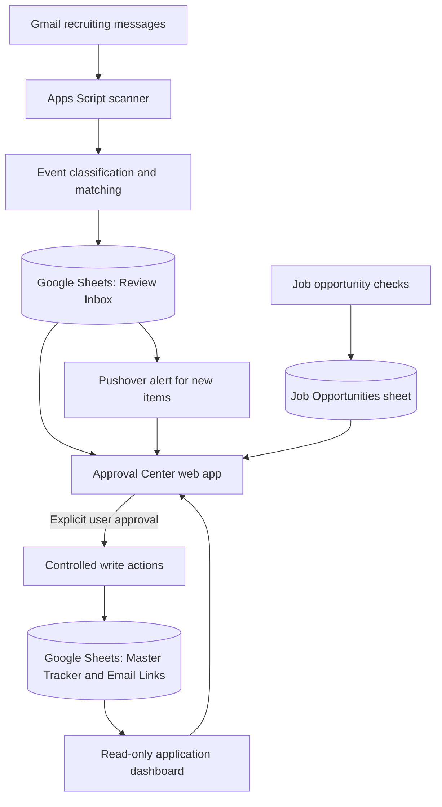

# Job Application Tracker

**Approval-first automation for tracking recruiting emails and job applications.**

A personal engineering project built with **Google Apps Script, Gmail, Google Sheets, an HTML/CSS/JavaScript Approval Center, and Pushover**. It turns recruiting emails into reviewable events without silently changing application records.

**CI:** Automated syntax and mocked regression tests via GitHub Actions.

> **Privacy and deployment:** This is a **portfolio-oriented reference source** derived from a private system. Personal one-off repair scripts, historical applicant records, and account configuration are deliberately excluded. It is **not a turnkey production deployment**. Never overwrite the original private Apps Script project with this example.

## Why this project?

Recruiting updates are spread across application portals, messages, and inboxes. This project organizes them into a single review workflow while prioritizing two engineering requirements: **no accidental changes to the source of truth** and **no duplicated notifications**.

## Features

| Capability | Implementation |
| --- | --- |
| Email monitoring | Scheduled Gmail scan, event classification, and `Review Inbox` staging |
| Application matching | Company, title, application/job IDs, duplicate checks, and manual-review fallbacks |
| Approval Center | Web interface for applications, approvals, detection, action queue, and opportunities |
| Controlled writes | Master Tracker creation/linking requires explicit approval; scanning is read-only against the Master Tracker |
| Push notifications | Pushover alerts for new review items, with a sent-ID ledger and a script lock |
| Opportunities | Separate open/recheck/archive views and evidence checks for application availability |
| Quality checks | Offline JavaScript and behavior tests run in GitHub Actions on pushes and pull requests |

## Architecture



**Design principle:** A detected email is not an approved application update. Review and approval are distinct steps. See [architecture details](docs/ARCHITECTURE.md).

## Explore without credentials

The repository includes an **isolated synthetic-data preview**:

1. Download or clone the repository.
2. Open [`demo/index.html`](demo/index.html) in a browser.
3. Try the tabs, search, status filters, and record details.

The preview runs entirely in the browser, contains **fictional employers and application records**, and makes **no requests** to Gmail, Sheets, Apps Script, or Pushover. Its styling and workflow are illustrative, not a pixel-perfect copy of the live Approval Center. See [demo walkthrough](docs/DEMO.md).

## Repository structure

```text
.github/workflows/ci.yml   # Offline checks on pushes and pull requests
demo/index.html            # Standalone, synthetic, read-only UI preview
docs/ARCHITECTURE.md       # Components, trust boundaries, approval flow
docs/DEMO.md               # Demo script and limitations
docs/ROADMAP.md            # Engineering follow-ups
docs/SECURITY.md           # Data-handling guidelines
src/*.gs                   # Genericized Apps Script reference modules
src/ApprovalPage.html      # Approval Center front end
src/appsscript.json        # Apps Script manifest
tests/*.test.cjs           # Offline regression checks
```

## Run tests locally

Requires **Node.js 20+**. No third-party dependencies or credentials are needed.

```bash
npm test
```

CI uses the same command. Tests cover parsing, key classifier/matching behavior, vacancy evidence checks, and notification failure/deduplication paths using mocks. They are **not** live Gmail/Sheets integration tests and do not prove the deployed automation is healthy at every moment.

## Configuration and security

A deployed instance would take account-specific settings from **Apps Script Script Properties** (not Git). See [`.env.example`](.env.example) for a nonsecret illustration and [security guidance](docs/SECURITY.md). Do **not** paste production credentials, live Sheet exports, real recruiting email content, or a personal Approval Center URL into Git or the demo.

The historical, one-off application repair scripts are excluded. The source contains illustrative employer aliases and placeholders; these do not configure an actual user account. Review all content before changing repository visibility, and do not treat the source as deploy-ready.

## Current status

- Core Approval Center flows and dashboards were manually verified in the live system (October 2026).
- A scheduled scan was observed finishing successfully; a manual Pushover test reached the phone.
- GitHub Actions CI passed after the initial test-suite commit.
- **Still to verify:** a genuine new recruiting email triggering one Pushover notification and linking to the correct deployed `/exec` Approval Center.
- **Still to harden:** performance of historical scans, maintenance scripts, deployment reproducibility, and a complete security review before public release.

[Engineering roadmap](docs/ROADMAP.md) · [Architecture](docs/ARCHITECTURE.md) · [Demo](docs/DEMO.md) · [Security](docs/SECURITY.md)

*Independent portfolio project; not an official Google, GitHub, or Pushover product.*
