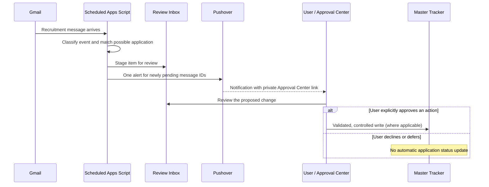

# Architecture and safety model

This document describes a **genericized reference architecture**, derived from a private project. The public source is not an exact deployable export.

## Components

| Component | Responsibility | Data boundary |
| --- | --- | --- |
| Gmail | Source of recruitment updates | Never modified by the scanning workflow |
| Apps Script scanner (`Code.gs`) | Collect and categorize relevant messages | Stages proposed events; does not write the Master Tracker |
| Matching engine (`JobTrackerEngine.gs`) | Determine candidates, IDs, confidence, and ambiguity | Ambiguous matches require review |
| Review Inbox (Google Sheets) | Queue of detected emails and review states | An inbox item is not a verified application |
| Approval Center (`ApprovalPage.html`) | Present records and user-controlled actions | Changes require specific approval actions |
| Application actions (`ApplicationApproval.gs`, other action modules) | Apply approved operations and maintain links | Must validate current state and IDs before writes |
| Master Tracker and Email Links (Google Sheets) | Persist application records and email links | Canonical application state |
| Notification module (`JobTrackerNotifications.gs`) | Notify when new Review Inbox IDs appear | Uses script lock and sent-ID record; no Master Tracker writes |
| Opportunities (`JobOpportunities.gs`) | Display job openings and availability evidence | Separate opportunity status from confirmed applications |

## Event flow

## Key invariants

1. **Email observation is not consent to modify an application.** A notification is informational.
2. **Scanning must not create applications or rewrite statuses in Master Tracker.**
3. **Distinct requisition IDs are not automatically collapsed**, even if company and title match.
4. **Role closure is not necessarily personal rejection.** Ambiguous wording stays reviewable.
5. **Push deduplication is independent of application status changes.** The sent-ID ledger is updated only after successful Pushover delivery acknowledgement.
6. **Demonstration data is isolated.** The standalone demo has no credentials, APIs, or production Sheets identifiers.

## Operational limitations

- Gmail scans can be expensive when many historical threads are revisited. The scanning range and concurrency controls need ongoing profiling.
- A successful mocked CI run does not verify OAuth permissions, trigger schedules, Apps Script quotas, or Pushover delivery in production.
- Personal one-off migration helpers have been excluded. Do not sync this genericized source over the original Apps Script project.
- The user's private web-app deployment and Sheet URLs are intentionally excluded from public-facing docs.

## Engineering follow-up

See [ROADMAP.md](ROADMAP.md). Highest-priority live proof: a real new recruiting email -> one new review item -> exactly one push -> correct `/exec` link -> user approval (if desired).
